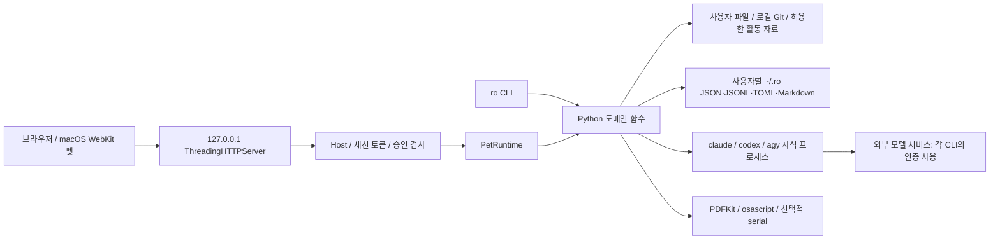

[세 보고서 목차](./README.md) · [원문 보관본](../../../workspace-snapshot/scratch/backend-audit/report.ko.md)

> 사용자가 지정한 백엔드 원본 보고서의 열람용 사본입니다. 별도 분석 채팅의 파일 작성 기록과 후속 수정 기록에서 원문을 복원했습니다. 본문 판단은 변경하지 않고 코드 링크만 분석 커밋에 고정했습니다. 원본이 참조하는 스크린샷·로그·재현 파일은 이번에 가져오지 못했으며 해당 위치를 본문에 표시했습니다.

**ro.bot 백엔드 심층 분석 — 2026-10-25 KST**

대상: `/workspace/ro.bot`, HEAD `23b38f56fa4f82390d721b70654acfa9e7c8b273`. Python 3.13.16 / Linux 환경. 제품 코드·설정·의존성 선언은 수정하지 않았다. 분석 스크립트와 결과는 `/workspace/scratch/backend-audit`에만 저장했다. 실험은 임시 디렉터리의 합성 파일·로그·Git 저장소, 가짜 엔진, 직접 띄운 loopback HTTP 서버를 사용했다. 실제 AI 전송·결제·알림·USB 접근·운영 데이터 변경은 하지 않았다.

접근 가능한 최근 동일 저장소의 이전 설정 작업에서는 설치·HTTP 점검 결과를 찾았지만, 인계받을 UX/UI 심층 분석 보고서는 확인하지 못했다. 이전 설정 작업의 테스트 수치와 HTTP 접근 보호를 현재 HEAD에서 재검증했다. 설계 문서의 과거 실사용·엔진 성공 사례는 이번 운영 검증으로 간주하지 않았다.

**1. 핵심 판단**

이 제품의 백엔드는 서버형 SaaS가 아니라 **단일 OS 사용자를 위한 로컬 파일 기반 애플리케이션**이다. Python CLI, 내장 HTTP 서버, 브라우저/WebKit UI가 같은 도메인 함수를 호출한다. DB·조직·계정·결제·분산 작업 큐가 없으므로 SQL 권한, 조직 테넌트, 결제 멱등성 문제를 억지로 적용하지 않았다.

가장 중요한 문제는 **이동·승인·복원 상태의 일치, 비밀정보 처리, 데이터 식별자**다. 정상적인 apply→undo 검사는 통과하지만 중간 실패나 경합에서는 보장이 깨진다. 서비스 분리나 DB 전환에 앞서 작업 ID, 승인 버전, 실패 복구 기록, 프로세스 간 잠금, 입출력 검증을 좁게 보완하는 것이 우선이다.

- 파일 이동 후 원장 쓰기에 실패하면 파일은 옮겨졌는데 undo 대상이 없다(B01).
- 목적지 존재 확인과 이동 사이에 다른 쓰기가 발생하면 기존 내용을 덮어쓴다(B02).
- 승인 미리보기 뒤 계획 수정·대기 요청 교체를 기존 승인으로 실행한다. `"false"` 문자열도 승인으로 처리한다(B03).
- 합성 PEM 본문·URL userinfo가 마스킹되지 않고, `ro route`는 마스킹 자체를 우회한다(B04).
- 같은 초·요약의 기록 ID 충돌, 같은 초의 배치 ID 재사용, 경로만으로 만든 파일 ID 때문에 다른 기록의 취소·복구 누락·새 파일 숨김이 발생한다(B05).
- 학습 승인은 여러 파일을 순서대로 갱신하므로 후보 유실 또는 기억 없는 승인 상태가 남는다(B06).

검증 수준: 기존 테스트 **353개 발견, 286개 통과, 66개 skip, 1개 실패 / 16.607초**. 새로운 격리 실험은 B01~B14의 구체적 실행 결과를 만들었다. P1은 다음 배포 전에 우선 처리할 항목, P2는 후속 개선 항목이다. 이 순위는 피해의 성격을 기준으로 하며 운영 발생률을 측정한 결과가 아니다.

**2. 시스템 지도와 불변 조건**



**구성 및 실제 책임**

| 영역 | 실제 구현 | 상태·경계 |
|---|---|---|
| 진입점 | [pyproject.toml](https://github.com/rhochoi/ro.bot/blob/23b38f56fa4f82390d721b70654acfa9e7c8b273/pyproject.toml#L16), [cli.py](https://github.com/rhochoi/ro.bot/blob/23b38f56fa4f82390d721b70654acfa9e7c8b273/ro/cli.py#L31), `python -m ro` | `ro = ro.cli:main`. `stats`, `distill`, `revise`, `adapters`는 별도 `python -m ro.<module>` 진입점도 제공 |
| HTTP | [pet.py](https://github.com/rhochoi/ro.bot/blob/23b38f56fa4f82390d721b70654acfa9e7c8b273/ro/pet.py#L4162) | stdlib ThreadingHTTPServer, 요청별 스레드. 임의 외부 주소 bind 금지, 기본 포트는 OS 할당 |
| 인증·인가 | [pet.py](https://github.com/rhochoi/ro.bot/blob/23b38f56fa4f82390d721b70654acfa9e7c8b273/ro/pet.py#L4176) | 정확한 Host+포트, `X-Ro-Token` 상수시간 비교. 토큰은 프로세스별 128비트. `/` HTML에서 부트스트랩. 계정·역할·OS peer 인증은 없음 |
| 상태 조정 | [PetRuntime](https://github.com/rhochoi/ro.bot/blob/23b38f56fa4f82390d721b70654acfa9e7c8b273/ro/pet.py#L196) | 질문 busy/취소/미리보기/쓰기 대기/직전 답변은 메모리. 일부 필드만 `threading.Lock` 보호. 프로세스 재시작 시 소실 |
| 프로젝트 지도 | [mapper.py](https://github.com/rhochoi/ro.bot/blob/23b38f56fa4f82390d721b70654acfa9e7c8b273/ro/mapper.py#L175), [ask.py](https://github.com/rhochoi/ro.bot/blob/23b38f56fa4f82390d721b70654acfa9e7c8b273/ro/ask.py#L42) | 설정한 루트에서 프로젝트·Git·문서 요약 수집. 개인 루트 설정이 있으면 지도 로딩 때 재필터링 |
| 질문·라우팅 | [ask.py](https://github.com/rhochoi/ro.bot/blob/23b38f56fa4f82390d721b70654acfa9e7c8b273/ro/ask.py#L228), [route.py](https://github.com/rhochoi/ro.bot/blob/23b38f56fa4f82390d721b70654acfa9e7c8b273/ro/route.py#L107) | 프로젝트 최대 3개, 컨텍스트 4,000자 + 활동 최대 1,800자. 사용자 routing → 저장소 routing → wheel 기본표. 명시 엔진/모델 선택 가능 |
| 기록·회상 | [records.py](https://github.com/rhochoi/ro.bot/blob/23b38f56fa4f82390d721b70654acfa9e7c8b273/ro/records.py#L81), [recall.py](https://github.com/rhochoi/ro.bot/blob/23b38f56fa4f82390d721b70654acfa9e7c8b273/ro/recall.py#L64) | 캡처는 서버에서 파일 경로를 열지 않고 전달된 이름·텍스트를 받음. 발췌 3줄. 취소는 revoke 이벤트, 분류는 별도 journal. 회상은 외부 모델 없이 로컬 계산 |
| 파일 정리 | [organize.py](https://github.com/rhochoi/ro.bot/blob/23b38f56fa4f82390d721b70654acfa9e7c8b273/ro/organize.py#L322), [detect.py](https://github.com/rhochoi/ro.bot/blob/23b38f56fa4f82390d721b70654acfa9e7c8b273/ro/detect.py#L49) | 분류·중복 SHA-256·압축 CRC·이름 버전·오래됨 판단. 최상위 파일만 이동/격리, 하위 파일은 남길 사본 탐지에 사용. 재무·계약 중요 파일 보호 규칙 |
| 수집·학습 | [collectors.py](https://github.com/rhochoi/ro.bot/blob/23b38f56fa4f82390d721b70654acfa9e7c8b273/ro/collectors.py#L298), [learn.py](https://github.com/rhochoi/ro.bot/blob/23b38f56fa4f82390d721b70654acfa9e7c8b273/ro/learn.py#L111), `stats/distill/revise` | 기본 수집 off. 허용 Git·zsh·codex/claude 세션. 통계→후보→승인→규칙/기억/개인 routing. durable job queue나 자동 스케줄러는 구현되어 있지 않음 |
| 외부 프로세스 | [route.py](https://github.com/rhochoi/ro.bot/blob/23b38f56fa4f82390d721b70654acfa9e7c8b273/ro/route.py#L152), [organize.py](https://github.com/rhochoi/ro.bot/blob/23b38f56fa4f82390d721b70654acfa9e7c8b273/ro/organize.py#L123), [ambient.py](https://github.com/rhochoi/ro.bot/blob/23b38f56fa4f82390d721b70654acfa9e7c8b273/ro/ambient.py#L50) | 엔진 기본 600초, stdout/stderr 펌프 스레드. PDF JXA는 40개씩 최대 120초. 알림 osascript 10초, serial 선택 의존성 |
| 설치·배포 | [install.sh](https://github.com/rhochoi/ro.bot/blob/23b38f56fa4f82390d721b70654acfa9e7c8b273/install.sh#L76), [release.yml](https://github.com/rhochoi/ro.bot/blob/23b38f56fa4f82390d721b70654acfa9e7c8b273/.github/workflows/release.yml#L1), [selfupdate.py](https://github.com/rhochoi/ro.bot/blob/23b38f56fa4f82390d721b70654acfa9e7c8b273/ro/selfupdate.py#L17) | Git 소스에서 uv/pipx 설치, main push 후 macOS unittest→날짜 태그→GitHub Release. `RO_REF`로 버전 지정 가능. 체크아웃 update는 `git pull --ff-only` |
| macOS host | [pet.py](https://github.com/rhochoi/ro.bot/blob/23b38f56fa4f82390d721b70654acfa9e7c8b273/ro/pet.py#L4307), `pet_mac.swift` | 실행 시 swiftc로 AppKit/WebKit/Carbon host 컴파일·사용자 UID별 임시 캐시. Linux에서는 네이티브 UI 검증 불가 |
| 보조 실행기 | [delegate.sh](https://github.com/rhochoi/ro.bot/blob/23b38f56fa4f82390d721b70654acfa9e7c8b273/scripts/delegate.sh#L34), `bench.py`, `ambient.py` | delegate는 brief 비밀 패턴 검사 후 codex workspace-write/agy 실행 및 별도 `.ro-delegate` 로그. bench는 외부 엔진 비교 실험. ambient는 ICS·serial·알림 |

**API 목록** — 아래 POST는 모두 같은 Host·토큰 검사를 통과해야 한다. 도메인 실패는 상당수가 HTTP 200 + `ok:false`이며, 잘못된 JSON은 400, 일반 예외는 500 + 예외 종류만 반환한다.

| 메서드·경로 | 입력 / 동작 |
|---|---|
| GET `/` | 토큰 포함 HTML. Host 검사만 수행 |
| GET `/api/state` | 화면 상태, 기록·규칙 후보·정리안·감사. 단순 조회 중 `learn.propose`가 pending 파일을 재생성할 수 있음 |
| POST `/api/ask/preview`, `/api/ask`, `/api/ask/cancel` | question/engine/project → 미리보기 ID → question/preview_id 실행 → 취소 event |
| POST `/api/feedback`, `/api/learn`, `/api/write_gate` | accepted / action+candidate id / approve. write_gate는 pending ID를 받지 않음 |
| POST `/api/recall` | question으로 로컬 기록 검색 |
| POST `/api/capture`, `/api/capture_undo`, `/api/capture_project` | kind/name/text/size → 기록, id → revoke, id+project → 수동 분류 |
| POST `/api/records/plan`, `/api/records/apply`, `/api/records/undo` | 기록 분류 미리보기, picks 선택 적용, 최신 배치 24시간 내 취소 |
| POST `/api/organize/scan`, `/api/organize/apply`, `/api/organize/undo` | 스캔, category/kind별 승인 대기 등록, 최신 복원 승인 대기 등록 |
| POST `/api/prefs`, `/api/focus`, `/api/clear`, `/api/action` | 설정 dict / on / 알림 닫기 / action+duration |

HTTP에는 영구 삭제 API가 없다. 파일 격리 비우기는 CLI에서만, 기본 7일(옵션 최소 1일), TTY와 정확한 `yes` 입력을 요구한다. 본문은 최대 32KiB만 읽지만 JSON object 및 필드 타입의 일관된 스키마 검증, 명시적 413 처리는 없다.

**저장 구조와 트랜잭션**

| 저장 위치 | 의미 | 쓰기·복구 보장 |
|---|---|---|
| `~/.ro/config.json`, `map.json` | 수집 허용·선호·루트·펫 설정 / 프로젝트 지도 | 임시 파일 후 `os.replace`; 파일 하나 교체는 원자적. read-modify-write 잠금 없음 |
| `log/YYYY-MM-DD.jsonl` | route·note·activity·feedback·관리 이벤트 | O_APPEND, 손상된 JSON 줄은 읽을 때 건너뜀. 고유 event ID 없음 |
| `cleanup/plan.json`, `cleanup/journal.jsonl`, `cleanup/trash/<batch>` | 파일 계획·복구 원장·격리본 | 이동과 원장은 별도 I/O. 구 organize/tidy 원장도 읽음 |
| `records/journal.jsonl` | 기록→프로젝트 분류 및 분류 취소 | event hash 참조. 참조 정합성 DB 제약 없음 |
| `pending.json`, `rules.json`, `rejected.json`, `ro-model.md`, `routing.toml` | 학습 후보·결정·기억·라우팅 | 각 파일은 개별 저장, 전체 승인 트랜잭션 없음 |
| `collect_state.json`, `stats/*.json`, `distill_state.json` | 수집 커서·집계·외부 호출 주차 | 이벤트 기록과 커서/호출권 저장은 별도 |
| `last_ask.json`, `bench/*.json`, `pet.pid` | CLI 후속 질문·평가 결과·프로세스 위치 | 파생 상태·로컬 파일, 자동 버전 백업이나 상태 전체 복원 프로토콜 없음 |

`fsutil`은 새 디렉터리 0700, 새/교체 파일 0600을 사용한다. 기존 디렉터리 권한을 자동으로 좁히지는 않는다. `audit --fix`는 별도 권한 수정 기능이다. `atomic_write` 및 JSONL append에 fsync가 없으므로 파일 교체 원자성과 전원 차단 시 내구성을 구분해야 한다. `~/.ro`를 자동 Git 저장소로 만들거나 모든 변경을 커밋하는 구현은 찾지 못했다.

**핵심 사용자 과업의 종단 경로**

| 과업 | 입력·권한·규칙 → 데이터 변경·경계 → 외부 부작용·응답 |
|---|---|
| 최초 설정·프로젝트 파악 | 사용자가 roots 지정/`ro map` 실행 → 깊이·제외 규칙으로 파일 목록, README/가이드 발췌, 로컬 Git 조회 → map.json 교체 후 map 이벤트. 지도 저장과 이벤트는 별도. 원본 파일 수정/외부 모델 호출 없음. 지도 없으면 ask는 안내하고 스캔하지 않음 |
| 펫에서 질문 | 인증된 preview(question, engine, project) → 지도·규칙·활동으로 계획 생성, 메모리에 ID와 원본 계획 저장 → 엔진·프로젝트·700자 컨텍스트 미리보기 → ask(question, preview_id), ID·질문 일치 및 600초 TTL 검사, busy 잠금 → 동일 계획으로 read-only/plan CLI 실행 → route 로그 후 last_answer 메모리 갱신 → ok/output. 외부 호출과 로그는 원자적이지 않음; 응답 후 로깅 실패 시 이미 외부 호출은 발생함 |
| CLI 질문·후속 질문 | `ro ask`는 프롬프트 표시 후 확인, 비대화형은 --yes 필요. 실행→route 로그→성공 시 last_ask 저장, 선택적 feedback. `ro route`는 저수준 별도 경로로 task를 직접 전달하며 --write에 확인 질문. 두 경로의 마스킹 계약이 다름(B04) |
| 기록 추가·회상·분류 | 토큰+kind/name/text/size → 3줄 발췌·프로젝트 이름 매칭 → note append 및 계산한 ID 반환. revoke는 원본 삭제 없이 취소 이벤트. 수동 분류는 존재하는 record ID·project 이름 검사 후 assignment append. 자동 분류는 후보가 하나인 기록 및 명시 picks만 적용. undo는 최근 분류 배치 전체를 24시간 내 취소. 외부 전송 없음 |
| 다운로드 정리·복원 | scan→최근 10분/다운로드 중/민감 이름/심링크 제외→로컬 내용 추출·분류→move/quarantine/keep 계획 저장. apply 요청은 펫에서 승인 대기만 생성→write_gate→created 검사→원본 위치·size·mtime·SHA 및 남길 사본 검증→격리 먼저, 이동 나중→각 이동 후 journal→마지막 요약 log. 배치 전체 롤백 없음, 일부 skip 허용. undo는 원위치 충돌·변경 해시 검사 후 역이동→restore append. HTTP는 done 0건이어도 ok:true가 될 수 있음 |
| 격리 비우기 | CLI에서 N일 경과 배치 선택→목록·파일 수·용량 표시→TTY `yes`→격리 루트 내부 일반 파일만 unlink→purge 원장. 삭제와 원장 기록은 별도. 삭제된 파일은 제품 undo 불가. 실험은 실제 사용자 격리함에 접근하지 않음 |
| 활동 수집·통계 | 허용된 소스만 read. Git 커밋, zsh 완료 줄, 30분 이상 변동 없는 세션 메타데이터→activity append→모든 소스 처리 후 커서 저장→collect 이벤트. 실패 시 이전 소스의 기록은 남고 커서는 이전 값일 수 있음. stats는 Git/ref·세션 revision 등의 중복을 일부 제거하지만 원본 UI/회상까지 정리하지 않음 |
| 학습·라우팅 개정 | route 로그/통계/bench→후보 생성→명시 approve/reject. approve: routing 종류는 먼저 TOML 검증·갱신→pending에서 제거→rules 추가→memory 종류는 Markdown 추가→호출자 승인 로그. 다중 파일 커밋 없음. 거절도 pending 제거와 rejected 기록이 별도. 외부 증류는 집계만 보내며 후보는 자동 승인하지 않음 |
| 외부 엔진 실패·중단 | 미설치 사전 검사, 인증 오류 문자열 판별, timeout/cancel 처리→직접 자식 kill/wait→출력 스레드 join→실패 이유. 일반 질문 busy는 finally에서 해제. durable 요청 ID·재시작 복구·외부 공급자 취소 확인은 없음 |
| 업데이트 | 사용자 update 명령→설치 방식별 git/uv/pipx 호출→종료코드 반환. 사전 사용자 데이터 스냅샷, 설치 후 마이그레이션 검증, 자동 롤백 없음. 태그 고정 설치는 가능하나 이번에 실제 업/다운그레이드는 실행하지 않음 |

**제품 불변 조건**

| ID | 반드시 성립해야 할 조건 | 현재 판정 |
|---|---|---|
| I1 | 승인한 작업 ID·계획 버전·대상·목적지가 실제 실행과 동일하며 정확한 boolean 승인만 수락 | B03 위반 |
| I2 | 원본을 움직인 모든 작업은 충돌 없이 추적·재시작·복원할 수 있고, 성공 응답과 실제 파일/원장이 일치 | B01/B02/B05 위반 |
| I3 | 별개 기록·작업·파일 버전은 별개 ID. 하나의 취소는 그 대상에만 적용 | B05 위반 |
| I4 | 학습 승인 시 pending/rules/memory/routing의 상태가 모두 일치하고 재시도로 회복 가능 | B06 위반 |
| I5 | 두 설정 변경이 모두 성공하면 두 변경 모두 보존 | B07 위반 |
| I6 | 수집 커서는 영속화된 모든 원본 이벤트까지만 전진. 재실행은 의미상 같은 이벤트를 중복 생성하지 않음 | B08/B09 위반 |
| I7 | 한 답변의 피드백은 하나의 관측치, 주당 외부 호출권은 한 번만 소비 | B10/B11 위반 |
| I8 | 비밀정보는 저장·외부 전송 경로 전체에서 제거/거부. audit 정상은 민감 데이터 부재의 증명이 아님 | B04 위반 |
| I9 | 취소/시간초과 완료는 해당 작업의 후손 프로세스 종료 또는 남은 작업의 명시적 보고를 의미 | B12 위반 |
| I10 | 손상·부분 실패·대상 부재를 사용자에게 구별 가능하게 알리고 복구에 필요한 자료를 보존 | B13 등 미충족 |
| I11 | 사용자별 파일은 OS 권한으로 분리되고, HTTP가 의도한 로컬 신뢰 범위를 넘지 않음 | 일반 원격 접근 방어 확인, 동일 기기 다른 사용자 경계는 C01 조건부 위험 |
| I12 | 설치본의 공개 명령이 소스 체크아웃 없이 필요한 모듈을 찾음 | serial 경로 B14 위반 |

**문서와 구현의 차이**

| 설명 | 현재 근거·차이 |
|---|---|
| README의 “7일 지난 배치만 비움” | [README 38](https://github.com/rhochoi/ro.bot/blob/23b38f56fa4f82390d721b70654acfa9e7c8b273/README.md#L38)과 달리 [organize._days](https://github.com/rhochoi/ro.bot/blob/23b38f56fa4f82390d721b70654acfa9e7c8b273/ro/organize.py#L889)는 최소 1일 허용. CLEANUP-DESIGN의 “기본 7일, 조정 가능”이 구현과 일치 |
| 설계의 `scan --deep` | [CLEANUP-DESIGN](https://github.com/rhochoi/ro.bot/blob/23b38f56fa4f82390d721b70654acfa9e7c8b273/docs/CLEANUP-DESIGN.md#L1)에 제시되어 있으나 현재 CLI 인자에 없음. 하위 파일은 남길 사본 탐지에만 사용 |
| 모든 행동 기록 / 언제든 undo / 변경 Git 복원 | 원장 이후 쓰기 실패·배치 ID 재사용에서 깨짐. 자동 Git 기록이나 데이터 백업 구현 없음. 사용자가 정리 후 내용을 바꾸거나 원위치에 파일을 만들면 undo가 거부되는 것은 기존 방어 규칙 |
| 메뉴바 설정·온보딩 계획 | 실제 설정 진입점 상당수는 CLI. doctor는 바이너리 존재만 확인하며 로그인 유효성/모델 응답은 검사하지 않음 |
| DIRECTION의 SQLite 이전·기억 경로·영구 삭제 미구현 설명 | 일부는 과거 제안/상태. 현재 저장은 JSONL, 기억은 `~/.ro/ro-model.md`, purge CLI는 구현됨 |
| 정리 수정→학습→다음 정리 반영 | 설계의 후순위 항목. 현재 learn.propose는 route 로그 기반이고 organize_edit를 분류 규칙으로 학습하지 않음. 미구현 계획과 회귀 결함을 구분해야 함 |
| “원본 외부 미전송” 및 “비밀 무저장” | 코드가 외부 CLI에 문서 발췌·요약·질문을 전달한다는 범위를 구체화해야 함. 엔진 자체가 추가로 읽는 파일은 각 CLI 권한·훅에 의존하며 이번에 실제 엔진 실행으로 검증하지 않음. 확인된 마스킹 누락은 B04 |

**3. 발견과 증거**

아래 ‘확인된 결함’은 현재 코드와 격리 실행으로 결과를 재현했다는 뜻이다. 실제 사용자 데이터에서 이미 발생했음을 뜻하지 않는다. E번호는 주 실험 (원본 첨부: `/workspace/scratch/backend-audit/reproduce.py`, 이 브랜치에는 미포함), 보충 실험 (원본 첨부: `/workspace/scratch/backend-audit/supplement.py`, 이 브랜치에는 미포함), wheel 실험 (원본 첨부: `/workspace/scratch/backend-audit/wheel_probe.py`, 이 브랜치에는 미포함)의 식별자다. 결과 원본: results.json (원본 첨부: `/workspace/scratch/backend-audit/results.json`, 이 브랜치에는 미포함), supplement-results.json (원본 첨부: `/workspace/scratch/backend-audit/supplement-results.json`, 이 브랜치에는 미포함), wheel-results.json (원본 첨부: `/workspace/scratch/backend-audit/wheel-results.json`, 이 브랜치에는 미포함).

**B01 · P1 · 확인된 결함 — 이동 후 원장 실패로 복구 대상 유실**

- 발생 조건: 실제 이동 성공 후 journal append에서 ENOSPC/I/O 오류. 강제 종료에도 같은 논리적 틈이 있으나 전원 차단 자체는 실험하지 않았다.
- 위치: [organize.apply](https://github.com/rhochoi/ro.bot/blob/23b38f56fa4f82390d721b70654acfa9e7c8b273/ro/organize.py#L575), [journal append](https://github.com/rhochoi/ro.bot/blob/23b38f56fa4f82390d721b70654acfa9e7c8b273/ro/organize.py#L589), [undo](https://github.com/rhochoi/ro.bot/blob/23b38f56fa4f82390d721b70654acfa9e7c8b273/ro/organize.py#L721).
- 재현 E01: `_append`에 합성 ENOSPC 주입. `source_exists=false`, `destination_exists=true`, `recovery_entries=0`.
- 영향: 파일 이동/격리 작업. 파일 바이트는 목적지에 남지만 일반 undo로 찾을 수 없다. 격리 후 chmod 실패도 원장 이전 실패이며, 여러 파일 중 앞부분만 처리될 수 있다.
- 기존 방어: 적용 전 해시·경로 검사, 정상 작업별 원장, 변조된 복원본 거부.
- 근본 원인: 외부 파일 변경을 먼저 수행하고 사후에만 복구 원장 작성. 파일시스템과 원장 간 복구 가능한 상태 전이가 없다.
- 최소 수정: 고유 op_id의 실행 의도(src/dst/hash)를 먼저 영속화하고 완료/실패를 기록. 시작 시 미완료 작업을 대사하는 작은 복구 경로 추가. 부분 완료를 응답에서 별도로 표시. 단순 순서 변경만으로 두 I/O가 원자적이 되지는 않음.
- 회귀 검증: 이동 전·직후·chmod·append·최종 log 각 지점 실패, 재시작 후 원장과 실파일 대사, 재실행 중복 이동 방지, 교차 볼륨 copy/delete 실패.

**B02 · P1 · 확인된 결함 — 목적지 충돌 검사 뒤 생긴 파일 덮어쓰기**

- 발생 조건: `_unique`가 목적지 부재를 확인한 다음 다른 프로세스가 같은 경로에 파일을 생성.
- 위치: [_unique](https://github.com/rhochoi/ro.bot/blob/23b38f56fa4f82390d721b70654acfa9e7c8b273/ro/organize.py#L292), [apply 이동](https://github.com/rhochoi/ro.bot/blob/23b38f56fa4f82390d721b70654acfa9e7c8b273/ro/organize.py#L582).
- 재현 E14: 정상 스캔 계획으로 실행하고 존재 확인 직후 임시 목적지에 별도 합성 내용을 생성했다. 이동은 1건 성공 처리됐지만 `concurrent_writer_content_preserved=false`.
- 영향: 정리 대상 외 파일의 내용 손실. 이번 실행은 Linux 동일 파일시스템; macOS 및 다른 파일시스템별 동작은 별도 검증 필요.
- 기존 방어: 순차 처리에서는 `_unique`가 이름 충돌을 피하고, 원본 SHA 검사로 바뀐 원본을 거부.
- 근본 원인: exists→move의 비원자적 검사. `shutil.move`는 목적지 보호를 보장하는 no-replace 연산이 아님.
- 최소 수정: 목적지를 배타적으로 예약하고 덮어쓰기 없는 이동/검증된 복사 절차 사용. 앱 내부 작업 잠금과 외부 쓰기 충돌 처리를 함께 고려.
- 회귀 검증: 존재 확인 이후 경쟁 파일/심링크 생성, 동시 apply/undo, 같은·다른 볼륨에서 양쪽 바이트가 보존되는지 검사.

**B03 · P1 · 확인된 결함 — 승인 대상·버전·입력 타입이 고정되지 않음**

- 발생 조건: 정리 승인 대기 중 CLI edit; 두 UI에서 대기 작업 교체; 잘못된 클라이언트가 `approve:"false"` 전송.
- 위치: [queue 및 resolve](https://github.com/rhochoi/ro.bot/blob/23b38f56fa4f82390d721b70654acfa9e7c8b273/ro/pet.py#L324), [정리 버전 검사](https://github.com/rhochoi/ro.bot/blob/23b38f56fa4f82390d721b70654acfa9e7c8b273/ro/pet.py#L445), [edit](https://github.com/rhochoi/ro.bot/blob/23b38f56fa4f82390d721b70654acfa9e7c8b273/ro/organize.py#L433), [HTTP bool 변환](https://github.com/rhochoi/ro.bot/blob/23b38f56fa4f82390d721b70654acfa9e7c8b273/ro/pet.py#L4249).
- 재현 E02: 미리보기 후 이름 edit, created 값 그대로, 승인 성공, 변경된 이름으로 이동. E10: A→B 대기 등록 후 첫 카드에 대한 승인 의도로 resolve하면 B 실행. E09: 인증된 요청의 문자열 `"false"`가 true로 변환되어 임시 파일 실제 이동.
- 영향: 펫 파일 정리·복원 및 쓰기 요청 게이트. 인증 우회가 아니라 인증 이후 잘못된 승인 적용이다. 정상 UI가 항상 boolean을 보내더라도 서버 경계의 결함은 남는다.
- 기존 방어: 잠금 안에서 pending을 한 번 꺼내고 지움, 계획 생성시각 비교, 실제 원본 재확인. ask preview는 별도 ID·질문·TTL·저장 계획을 검증하는 더 강한 흐름이 있음.
- 근본 원인: write_gate는 요청 ID 없이 최신 전역 슬롯을 승인하고, 계획 변경 버전으로 불변 생성시각을 사용하며 Python truthiness로 승인 판정.
- 최소 수정: pending_id+plan_revision/hash+확정된 대상 ID/목적지 목록을 전달·검증·원자적으로 소비. edit/scan마다 revision 변경. boolean 외 입력 400으로 거부. 오래된 카드는 새 미리보기 요구.
- 회귀 검증: 카드 A 표시→B 등록→A 승인 거부, edit/동일 초 rescan 후 거부, replay 한 번만 실행, false/null/문자열/배열/누락 타입별 부작용 0.

**B04 · P1 · 확인된 결함 — 민감정보 마스킹 경로와 패턴의 누락**

- 발생 조건: 질문/기록에 여러 줄 PEM 형태 입력, userinfo 포함 URL 저장, `ro route`에 알려진 비밀 할당 패턴 입력.
- 위치: [redact](https://github.com/rhochoi/ro.bot/blob/23b38f56fa4f82390d721b70654acfa9e7c8b273/ro/log.py#L16), [URL 정리](https://github.com/rhochoi/ro.bot/blob/23b38f56fa4f82390d721b70654acfa9e7c8b273/ro/records.py#L76), [route 직접 전달](https://github.com/rhochoi/ro.bot/blob/23b38f56fa4f82390d721b70654acfa9e7c8b273/ro/cli.py#L316), [audit](https://github.com/rhochoi/ro.bot/blob/23b38f56fa4f82390d721b70654acfa9e7c8b273/ro/harden.py#L42).
- 재현 E08: 합성 PEM의 BEGIN 헤더만 마스킹되고 본문 marker는 프롬프트/로그에 남았다. URL의 가짜 인증정보도 로그에 남았다. 감사의 비밀 패턴 발견은 0건. E17: `log.redact`가 잡는 합성 `token=...` 입력도 CLI route→mock runner에는 원문 그대로 전달됐다. 실제 비밀·외부 전송은 사용하지 않았다.
- 영향: 질문 전송, 기록, 후속 재사용 및 audit 결과 해석. 일반 자유문장 전체의 개인정보 제거를 보장하는 구현도 아님.
- 기존 방어: 알려진 API key/JWT/할당 패턴·키 이름 마스킹, ask 프롬프트 마스킹, 홈 경로 치환, 민감 파일명 제외. delegate 출력에는 별도의 PEM 블록 제거가 있어 처리 방식이 일관되지 않음.
- 근본 원인: 공유 비밀 패턴은 PEM 전체 블록을 소비하지 않고 URL netloc을 그대로 유지. 공통 외부 전송 함수에서 정책을 강제하지 않음. audit가 redactor와 유사한 제한된 패턴만 확인.
- 최소 수정: 완전한 PEM 블록/중단된 블록 처리, URL userinfo 거부 또는 제거, 모든 엔진 호출 직전 일관된 마스킹/거부 정책. audit의 검사 범위와 비검출 한계를 명시.
- 회귀 검증: 합성 다중행·줄바꿈·절단·인코딩·userinfo 입력을 CLI/Pet/저장/외부 runner 경로에서 비교. 출력과 파일에 원문 marker가 없음을 검증. 민감 원문은 테스트 실패 출력에서도 노출하지 않음.

**B05 · P1 · 확인된 결함 — 식별자 재사용으로 취소·복구·새 파일 상태가 섞임**

- 발생 조건: 같은 초에 같은 첫 줄/요약의 별개 기록; 같은 초 apply→undo→apply; 이전 파일을 옮긴 뒤 같은 원본 경로에 새 파일 생성.
- 위치: [event ID](https://github.com/rhochoi/ro.bot/blob/23b38f56fa4f82390d721b70654acfa9e7c8b273/ro/records.py#L44), [초 단위 timestamp](https://github.com/rhochoi/ro.bot/blob/23b38f56fa4f82390d721b70654acfa9e7c8b273/ro/log.py#L55), [batch ID](https://github.com/rhochoi/ro.bot/blob/23b38f56fa4f82390d721b70654acfa9e7c8b273/ro/organize.py#L545), [closed 판정](https://github.com/rhochoi/ro.bot/blob/23b38f56fa4f82390d721b70654acfa9e7c8b273/ro/organize.py#L512), [경로 ID](https://github.com/rhochoi/ro.bot/blob/23b38f56fa4f82390d721b70654acfa9e7c8b273/ro/organize.py#L343), [UI 제외](https://github.com/rhochoi/ro.bot/blob/23b38f56fa4f82390d721b70654acfa9e7c8b273/ro/pet.py#L353).
- 재현 E03: 내용이 다른 두 기록의 ID 같음, 2건 중 한 건 revoke 후 live=0. E15: 같은 batch ID로 재적용 1건, 목적지 존재, pending 복구 0건. E16: 새 파일 계획은 1건인데 펫 준비 건수 0·queue 실패.
- 영향: 기록 일부 숨김·분류 공유, undo 목록 유실, 정리 가능한 새 다운로드가 UI에서 사라짐. 이는 우연한 SHA 충돌이 아니라 해시 입력/시간/경로의 결정적 재사용이다.
- 기존 방어: journal은 남고 기록 취소는 물리 삭제하지 않음. SHA는 파일 변경 감지에 사용하지만 업무 식별자에는 반영되지 않음.
- 근본 원인: 내용 요약을 event identity로, 초를 operation identity로, 경로를 file-version identity로 사용.
- 최소 수정: 이벤트와 작업에 영속 UUID, 계획별 항목 ID 또는 파일 버전 fingerprint. old ID 참조 호환을 포함해 revoke·assign·pending·UI 필터를 함께 수정. 기존 충돌 기록을 자동으로 어느 한 건에 재할당하지 말 것.
- 회귀 검증: 같은 시각 동일 요약 100건 각각 revoke, 같은 시각 apply/undo/reapply, 같은 경로 새 파일, 기존 journal 마이그레이션 후 복원 범위 검사.

**B06 · P1 · 확인된 결함 — 학습 승인 중간 실패가 유실/부분 반영 상태를 남김**

- 발생 조건: pending 제거 후 rules 저장 실패, rules 저장 후 memory 저장 실패.
- 위치: [learn.approve](https://github.com/rhochoi/ro.bot/blob/23b38f56fa4f82390d721b70654acfa9e7c8b273/ro/learn.py#L111), [_pop](https://github.com/rhochoi/ro.bot/blob/23b38f56fa4f82390d721b70654acfa9e7c8b273/ro/learn.py#L102), [reject](https://github.com/rhochoi/ro.bot/blob/23b38f56fa4f82390d721b70654acfa9e7c8b273/ro/learn.py#L146).
- 재현 E04a: ENOSPC 뒤 pending=0/rules=0. E04b: pending=0/rules=1/memory 파일 없음. routing은 TOML을 가장 먼저 바꾸므로 그 뒤 실패 시 반영된 routing과 후보 상태가 달라질 수 있음(해당 순서는 코드 확인, 별도 장애 주입은 하지 않음).
- 영향: 후보 유실, ‘승인됨’ 규칙과 실제 기억 불일치, 재시도 시 후보 없음. 동일 문제군이 reject에도 존재.
- 기존 방어: 개별 파일 atomic replace, routing의 현재값 비교·결과 검증, 손상 JSON 백업.
- 근본 원인: 승인 결정과 파생 파일 갱신을 여러 파일에 비원자적으로 기록하고 중간 상태/재처리 키가 없음.
- 최소 수정: 승인 결정/op_id를 먼저 기록하고 rules/memory/routing을 멱등적으로 적용한 뒤 완료 처리. 실패 시 pending을 유지하거나 복구 대기 상태 표시. 꼭 DB를 도입할 필요는 없음.
- 회귀 검증: 각 쓰기 단계의 실패·프로세스 종료·재시작·반복 승인에서 한 번 반영 및 후보 보존, routing 변경 충돌 시 부분 승인 없음.

**B07 · P2 · 확인된 결함 — 원자적 파일 교체가 동시 설정 변경을 보존하지 못함**

- 발생 조건: 두 HTTP 요청/CLI가 동일 config를 읽은 뒤 각각 다른 필드를 저장.
- 위치: [config.update](https://github.com/rhochoi/ro.bot/blob/23b38f56fa4f82390d721b70654acfa9e7c8b273/ro/config.py#L25), [pet prefs](https://github.com/rhochoi/ro.bot/blob/23b38f56fa4f82390d721b70654acfa9e7c8b273/ro/pet.py#L250), [fsutil.atomic_write](https://github.com/rhochoi/ro.bot/blob/23b38f56fa4f82390d721b70654acfa9e7c8b273/ro/fsutil.py#L15).
- 재현 E05: barrier로 두 read를 같은 상태에 맞춤. 두 호출 성공, 최종 JSON에는 engine 또는 pet 중 한 키만 남음.
- 영향: 선호·화면 설정·루트·수집 허용 설정이 동시 갱신될 때 갱신 유실. 동시 동의 변경이 어떤 결과를 만드는지는 별도 테스트 필요.
- 기존 방어: JSON 파일 부분 쓰기는 방지, 각 함수는 기존 항목을 merge하려고 함.
- 근본 원인: read-modify-write 범위의 직렬화/CAS 없음. 파일 교체 자체의 원자성과 갱신 원자성을 혼동.
- 최소 수정: 상태 디렉터리/파일별 프로세스 간 잠금 또는 revision CAS. UI의 메모리 lock만으로 CLI와의 경합까지 막을 수 없음.
- 회귀 검증: 서로 다른 키 동시 수정 보존, 같은 키 충돌 정책, 두 프로세스 실행, 잠금 보유 프로세스 종료 후 복구.

**B08 · P2 · 확인된 결함 — Git 수집이 200건 초과분을 영구적으로 건너뜀**

- 발생 조건: 저장된 cursor 이후 수집 대상 커밋이 200개 초과.
- 위치: [collect_git](https://github.com/rhochoi/ro.bot/blob/23b38f56fa4f82390d721b70654acfa9e7c8b273/ro/collectors.py#L114).
- 재현 E06: 원격 없는 합성 Git 저장소에서 cursor 이후 205커밋 생성. 첫 수집 200, 다음 수집 0, cursor는 HEAD. 5개는 후속 실행으로 채워지지 않음.
- 영향: 활동 회상·프로젝트 통계·후속 증류의 누락. 실사용 빈도는 미측정.
- 기존 방어: author 필터, 기존 HEAD의 ancestor 확인, 초기 30일 범위 제한.
- 근본 원인: 조회 `--max-count=200`와 무조건 `state=HEAD`가 결합. 제한된 페이지를 소비했는데 전체 범위를 처리했다고 표시.
- 최소 수정: cursor~HEAD 범위를 페이지로 완주하거나 처리한 연속 구간 끝까지만 전진. 첫 수집 제한과 증분 처리 보장을 분리.
- 회귀 검증: 199/200/201/205건, 다른 작성자 혼합, merge/rebase/force-push 후 커밋 ID 집합 대사.

**B09 · P2 · 확인된 결함 — 수집 커서 저장 실패 후 재실행 시 원본 이벤트 중복**

- 발생 조건: activity append 성공 후 collect_state 저장 실패/재실행.
- 위치: [collectors.run](https://github.com/rhochoi/ro.bot/blob/23b38f56fa4f82390d721b70654acfa9e7c8b273/ro/collectors.py#L298), [stats 중복 제거](https://github.com/rhochoi/ro.bot/blob/23b38f56fa4f82390d721b70654acfa9e7c8b273/ro/stats.py#L21).
- 재현 E07: 합성 수집기와 cursor 저장 장애 주입 후 재시도. 같은 내용 ID 1개에 activity 2건.
- 영향: 원본 로그, 펫 기록 수·회상 중복. stats는 Git/세션 중복 일부를 제거하므로 모든 통계가 무조건 두 배가 된다고 단정하지 않는다.
- 기존 방어: 커서, session revision, stats dedupe, dry-run 무변경.
- 근본 원인: 이벤트와 cursor가 별도 커밋, raw 이벤트 수준의 안정적 source event ID·중복 거부 없음.
- 최소 수정: 원본 소스별 event key와 저장 단계의 멱등 처리, 커서는 처리 완료 이벤트까지만 업데이트. 기록 계층과 통계 계층의 동일한 의미 정의.
- 회귀 검증: source별 중간 실패 후 두 번 실행, 두 collector 동시 실행, 로그/회상/집계의 이벤트 수 대사.

**B10 · P2 · 확인된 결함 — 같은 답변의 피드백 재요청이 표본을 늘림**

- 발생 조건: 동일 답변에 feedback 요청 반복 또는 응답 유실 후 재전송.
- 위치: [record_feedback](https://github.com/rhochoi/ro.bot/blob/23b38f56fa4f82390d721b70654acfa9e7c8b273/ro/pet.py#L720), [revise.collect](https://github.com/rhochoi/ro.bot/blob/23b38f56fa4f82390d721b70654acfa9e7c8b273/ro/revise.py#L62).
- 재현 E11: 답변 1건에 수용 요청 3회 → feedback 이벤트 3건.
- 영향: 수용률·최소 피드백 표본 조건이 왜곡되어 라우팅 개정 후보 근거에 영향. 개정은 다시 승인해야 하므로 자동 라우팅 변경은 아니다.
- 기존 방어: 실패한 답변의 평가 거부, UI용 feedback_given 표시.
- 근본 원인: 이미 평가했는지 서버에서 거부하지 않고 answer/request ID 없이 모든 feedback을 별개 관측치로 집계.
- 최소 수정: answer_id+평가 결정 ID로 멱등 저장. 평가 수정이면 교체/정정 이벤트 정책 명시. CLI feedback도 같은 규칙 적용.
- 회귀 검증: 반복/동시/재시작 후 같은 답변 평가 한 건, 오래된 답변 평가가 최신 답변에 붙지 않음, 개정 통계 대사.

**B11 · P2 · 확인된 결함 — 외부 증류 주 1회 한도의 동시 실행 우회**

- 발생 조건: 두 실행이 같은 주차의 미사용 상태를 읽고 runner 호출에 진입.
- 위치: [distill.external_candidates](https://github.com/rhochoi/ro.bot/blob/23b38f56fa4f82390d721b70654acfa9e7c8b273/ro/distill.py#L111).
- 재현 E12: 두 fake runner가 barrier에 동시에 도달, 호출 수 2. 실제 외부 호출 0.
- 영향: 명시된 주당 호출/비용 상한 초과. 실제 청구 금액은 측정하지 않았다.
- 기존 방어: 순차 실행 주차 검사, 실패도 한도 소비, 4KiB/5후보/160자 제한.
- 근본 원인: 호출권을 예약하지 않고 외부 호출 후 상태 저장.
- 최소 수정: 프로세스 간 잠금 하에서 해당 주차 실행권을 먼저 영속 예약. 결과/실패 상태 보관. 호출 뒤 응답을 잃은 경우 무조건 재시도하지 않는 정책 정의.
- 회귀 검증: 두 프로세스 동시 시작·호출 전후 crash·week 전환, 공급자 idempotency가 없을 때 unknown 상태 처리.

**B12 · P2 · 확인된 결함 — 시간초과가 자식 프로세스 트리까지 종료하지 않음**

- 발생 조건: 엔진 CLI가 후손 프로세스를 생성한 뒤 timeout/cancel.
- 위치: [route.run](https://github.com/rhochoi/ro.bot/blob/23b38f56fa4f82390d721b70654acfa9e7c8b273/ro/route.py#L160), [kill](https://github.com/rhochoi/ro.bot/blob/23b38f56fa4f82390d721b70654acfa9e7c8b273/ro/route.py#L181).
- 재현 E13: 합성 Python 부모·자식으로 timeout 0.1초. 결과 reason=timeout 이후에도 후손이 임시 완료 marker를 생성했다.
- 영향: 후손이 추가 I/O/통신을 수행하는 엔진에서 취소 뒤 작업 지속 가능. 실제 claude/codex/agy의 프로세스 구조와 공급자 취소는 미검증이다. 원격 서비스 작업은 로컬 종료와 별도로 남을 수 있음.
- 기존 방어: 직접 자식 kill/wait, stdin 차단, 펌프 스레드 join, Pet busy finally 해제.
- 근본 원인: 별도 process session/group을 만들지 않고 직접 Popen PID만 종료.
- 최소 수정: 작업별 프로세스 그룹 생성 후 TERM→제한 시간→KILL 및 수거. 원격 완료 여부를 알 수 없으면 ‘취소 요청/결과 불명’을 구분.
- 회귀 검증: 후손/손자·파이프 상속·신호 무시 프로세스, timeout/Cancel/앱 종료 후 살아 있는 작업 프로세스와 추가 파일 변경이 없는지 확인.

**B13 · P2 · 확인된 결함 — 손상 기록이 정상적인 ‘기록 없음’으로 축소되고 탐지되지 않음**

- 발생 조건: JSONL에 부분 쓰기/손상 줄, 혹은 API 입력이 JSON object가 아닌 배열.
- 위치: [log.read](https://github.com/rhochoi/ro.bot/blob/23b38f56fa4f82390d721b70654acfa9e7c8b273/ro/log.py#L66), [organize.read_journal](https://github.com/rhochoi/ro.bot/blob/23b38f56fa4f82390d721b70654acfa9e7c8b273/ro/organize.py#L495), [audit](https://github.com/rhochoi/ro.bot/blob/23b38f56fa4f82390d721b70654acfa9e7c8b273/ro/harden.py#L30), [HTTP guard](https://github.com/rhochoi/ro.bot/blob/23b38f56fa4f82390d721b70654acfa9e7c8b273/ro/pet.py#L4190).
- 재현 E18: 정상 1줄+잘린 1줄 저장 → 반환 1건, audit findings=0. E09: 인증된 `/api/capture`에 `[]` → 500. HTTP 일반 예외는 종류만 응답하고 진단 이벤트는 기록하지 않음(코드 확인).
- 영향: 기록 누락·복원 원장 누락이 발견되지 않거나 잘못된 입력이 서버 장애로 표시. 모든 손상 파일이 건강한 것으로 표시된다는 주장은 아님; rules JSON은 별도 손상 처리 있음.
- 기존 방어: 손상 줄 때문에 전체 앱이 중단되지 않음, 원본 줄을 지우지 않음, HTTP 오류에 개인정보 경로를 노출하지 않음, learn JSON은 corrupt 백업.
- 근본 원인: 읽기 복원력과 데이터 품질 신호가 분리되지 않았고, 스키마 검사·오류 코드·추적 ID가 없음.
- 최소 수정: 손상 개수/파일/줄 위치를 민감 본문 없이 별도 진단 상태로 노출. API 타입 검증 400, 작업 ID·단계·예외 종류만 남기는 구조화된 장애 기록. GET state의 후보 재생성 부작용도 명확히 분리/직렬화.
- 회귀 검증: 잘린 줄/유효하지만 잘못된 JSON 타입/쓰기 실패/복원 실패에 대해 정상 빈 상태와 구분, 개인정보 없는 진단, 손상 원본 보존 및 복구 도구로 대사.

**B14 · P2 · 확인된 결함 — 배포 wheel의 serial 기능이 모듈 누락으로 실패**

- 발생 조건: 저장소 루트 없이 wheel 설치본에서 `ro ambient serial` 실행, pyserial이 이미 있어도 실패.
- 위치: [ambient.serial_lines](https://github.com/rhochoi/ro.bot/blob/23b38f56fa4f82390d721b70654acfa9e7c8b273/ro/ambient.py#L50), [wheel packages 설정](https://github.com/rhochoi/ro.bot/blob/23b38f56fa4f82390d721b70654acfa9e7c8b273/pyproject.toml#L19).
- 재현 E20: 환경에 있던 wheel 내부 모든 ro/*.py를 현재 checkout과 바이트 비교해 일치 확인. `serial_link.py`는 wheel에 없음. `-I -S` 독립 프로세스에서 wheel만 import하고 serial import를 가짜 모듈로 제공했을 때 `ModuleNotFoundError: serial_link`. 장치 접근 없음.
- 영향: 설치본의 serial 입력 경로. 체크아웃 테스트나 editable 설치로는 가려질 수 있음. macOS UI 파일은 wheel에 포함되어 있음.
- 기존 방어: serial extra로 pyserial 선택 설치, 장치 없음 안내 코드는 존재하지만 누락 import보다 뒤에 있음.
- 근본 원인: 루트 `serial_link.py`에 의존하면서 배포는 ro 패키지만 포함.
- 최소 수정: helper를 ro 내부로 포함하거나 wheel에 명시 포함하고 패키지 경로 import로 통일.
- 회귀 검증: wheel을 새 환경에 설치하고 저장소 외 cwd에서 serial mock smoke test. 선택 의존성 미설치·장치 없음·장치 오류를 각각 구분.

**조건부 위험과 자료 부족 — 확인된 결함과 분리**

| 구분 | 조건·코드·근거 | 영향·기존 방어 | 최소 방향·검증 |
|---|---|---|---|
| C01 조건부 위험: 같은 기기의 다른 사용자/프로세스 | `/`는 Host만 맞으면 토큰 포함 HTML 반환(E09), OS peer 사용자 확인 없음 [pet.py](https://github.com/rhochoi/ro.bot/blob/23b38f56fa4f82390d721b70654acfa9e7c8b273/ro/pet.py#L4210) | 원격 임의 Host와 토큰 없는 API는 403. 그러나 loopback은 사용자별 격리가 아니므로 다른 로컬 계정/프로세스가 토큰을 가져갈 수 있는 배치에서 서버 사용자 권한으로 조작 가능. 실제 다른 OS 계정 실험은 하지 않음 | 개인 단일 사용자 기기라는 신뢰 모델 명시. 공유 호스트 지원 시 사용자 권한 Unix socket/인증된 bootstrap 등 경계 강화. 두 OS 계정으로 접근 검증 |
| C02 조건부 위험: 전원 차단·교차 볼륨 장애 | atomic_write/append에 fsync 없음, shutil.move가 다른 볼륨에서 copy+delete 가능 [fsutil.py](https://github.com/rhochoi/ro.bot/blob/23b38f56fa4f82390d721b70654acfa9e7c8b273/ro/fsutil.py#L15) | atomic replace와 해시 검사는 존재하지만 crash durability와 복사 중단 복구는 미확인 | B01 복구 프로토콜 이후 실제 볼륨·강제 종료·디스크 full·fsync 순서 검증 |
| C03 조건부 위험: 로컬 리소스 고갈 | ThreadingHTTPServer, 수신 timeout/활성 요청 제한 없음; 엔진 stdout/stderr는 메모리에 누적 [route.py](https://github.com/rhochoi/ro.bot/blob/23b38f56fa4f82390d721b70654acfa9e7c8b273/ro/route.py#L163) | loopback/토큰, 입력 32KiB 읽기 제한, 질문 busy는 있음. 모든 endpoint·대량 출력·느린 body에 대한 상한은 아님 | 로컬 클라이언트 동작 근거를 보고 제한 추가. bounded 출력·본문 크기 오류·수신 timeout 부하 실험. 현재 성능 장애로 단정하지 않음 |
| 판단 불가: 실제 모델 보안·품질·취소 | 실제 CLI 로그인·버전별 plan/read-only 동작·프로젝트 hook·원격 서비스 작업을 실행하지 않음 | 소스상 모드 인자 확인만 가능. doctor 정상은 인증 정상의 증거 아님 | 사용자 승인된 비민감 fixture로 각 엔진별 권한·출력·취소 contract test |
| 판단 불가: 운영 복구율·발생률·SLO | 운영 로그·백업 정책·복구 훈련·트레이스·대상 Mac 성능 자료 미제공 | 설계 문서의 과거 실험 서술은 이번 실행 증거와 구분 | 실제 기기의 비식별 집계, 백업 복구 시연, 릴리스 이력·사용량을 별도 확보 |

C01은 조직 데이터 격리 기능을 요구하는 항목이 아니다. 현재 제품이 어느 로컬 사용자까지 신뢰하는지의 경계 문제다. 조직/테넌트 모델과 결제 webhook·분산 재시도 큐는 현재 구현에 없으므로 해당 항목은 적용하지 않았다.

**테스트와 성능 증거**

실행: 저장소에서 `GIT_CONFIG_NOSYSTEM=1 PYTHONDONTWRITEBYTECODE=1 .venv/bin/python -m unittest discover -s tests -t .`. 전체 결과 (원본 첨부: `/workspace/scratch/backend-unittest.log`, 이 브랜치에는 미포함).

- 286 pass / 66 skip / 1 fail. skip은 Swift 및 선택 Playwright/Chromium/axe 검사 등으로, Linux에서 UI 실동작 검증 완료를 뜻하지 않는다.
- 실패: [test_install.py:131](https://github.com/rhochoi/ro.bot/blob/23b38f56fa4f82390d721b70654acfa9e7c8b273/tests/test_install.py#L131). PATH에 `/usr/bin:/bin`을 넣고 gh 미설치를 가정하지만 이 환경에는 gh가 있다. 기대한 ‘gh 필요’ 대신 비대화형 `/dev/tty` 오류. 저장소 구현 회귀와 환경 의존 fixture 문제를 분리한다. assertion/환경 실행 파일을 바꾸어 통과시키지 않았다.
- 기존 tests는 정상 apply/undo, 변경된 파일/심링크 거부, API Host/토큰, 미리보기, 엔진 오류·취소, dry-run·수집 허용, 마스킹 표본을 검증한다. `test_harden`의 evaluate도 통과했지만 이번 결함을 배제하지는 못한다.
- 위 B항목 실험은 실패 지점 주입, 동시 read 장벽, 고정 시각, 정상 로컬 Git, 실 HTTP 요청을 사용했다. 내부 함수를 조절한 실험은 가능한 실행 순서를 검증한 것으로, 운영에서 발생하는 빈도를 측정한 것이 아니다.
- wheel은 이번에 재빌드하지 않고 기존 산출물의 Python 소스를 현 HEAD와 대사한 후 독립 import를 검증했다. 코드 배포, 업데이트, 롤백은 실행하지 않았다.

성능 실험은 단일 Python 프로세스·Linux·합성 당일 note 로그·hot filesystem 조건이다. 파일 하나에 직렬화한 뒤 첫 snapshot, 변경 없는 5회 snapshot 중앙값, note 1건 추가 직후 snapshot을 측정했다. 첫 회와 변경 직후는 각각 1회 표본이므로 p95나 운영 SLO로 사용하면 안 된다.

| 당일 이벤트 수 | JSONL 크기 | 첫 상태 생성 | 변경 없는 상태 중앙값(5회) | 1건 추가 후 상태 생성 |
|---:|---:|---:|---:|---:|
| 1,000 | 90,890 B | 6.66ms | 0.30ms | 4.70ms |
| 10,000 | 918,890 B | 66.56ms | 1.32ms | 51.62ms |
| 100,000 | 9,288,890 B | 461.87ms | 16.89ms | 563.12ms |

해석: [pet._disk_state](https://github.com/rhochoi/ro.bot/blob/23b38f56fa4f82390d721b70654acfa9e7c8b273/ro/pet.py#L481)의 변경 감지/30초 감사 캐시는 효과가 있다. 파일이 바뀌면 전체 로그 재파싱·후보 계산·감사가 발생한다. 이 합성 10만 건 조건에서는 UI 주석의 450ms 폴링 주기보다 재계산이 길었다. 캐시 적중 시에도 당일 기록 목록 순회 비용이 남는다. 실제 보유량·다중 날짜·대상 Mac·동시 요청·PDF 크기·디스크 조건을 측정하지 않았으므로 ‘확장 불가’ 또는 ‘성능 문제 없음’으로 결론 내리지 않는다. DB가 없으므로 SQL 실행계획은 해당하지 않는다.

재현 명령은 제품 데이터를 읽거나 외부 서비스를 호출하지 않는다. 직접 호출한 임시 HTTP 서버와 임시 파일만 사용한다.

```bash
cd /workspace/ro.bot
PYTHONDONTWRITEBYTECODE=1 .venv/bin/python /workspace/scratch/backend-audit/reproduce.py
PYTHONDONTWRITEBYTECODE=1 .venv/bin/python /workspace/scratch/backend-audit/supplement.py
PYTHONDONTWRITEBYTECODE=1 .venv/bin/python /workspace/scratch/backend-audit/wheel_probe.py
```

**4. 우선순위와 검증 계획**

| 순서 | 최소 변경 범위 | 통과 기준 |
|---|---|---|
| 1 · 데이터·승인 경계 | B01/B02/B03/B05: 작업 UUID, 승인 revision/대상 고정, write-ahead 복구 상태, no-replace 이동 | 모든 주입 실패/경합/재실행에서 원본·목적지 바이트 보존, 불일치 작업 식별, 다른 카드 승인 0건, undo 대상 정확 |
| 2 · 민감정보·학습 정합성 | B04/B06: 통합 마스킹 계약, PEM/URL 처리, 승인 결정과 파생 파일의 멱등 반영 | 합성 marker 유출 0, 승인 단계별 실패 후 재시작으로 복구, pending/rules/memory/routing 일치 |
| 3 · 정확한 집계·실행 한도 | B07~B11: 상태 잠금/CAS, Git 페이지 처리, source event/answer/request ID, 호출권 선예약 | 205건→205건 보존, 재실행 raw/집계 동일, 평가 1회, 주당 실행권 1회 |
| 4 · 운영·배포 | B12~B14: process group 종료, 진단 이벤트·손상 경고, wheel 독립 smoke test | 후손 잔존 없음, 무내용 진단으로 실패 단계 추적, 설치본 공개 기능 점검 |
| 5 · 제품과 성능 | 아래 인계 항목과 실제 Mac 부하 조건 | 제품 상태·응답·디스크 결과 일치, 측정 기반 예산 수립 |

기존 데이터를 대상으로 자동 복구하거나 ID를 일괄 변경하기 전에, 읽기 전용 대사로 모호한 기록과 복구 불가 항목을 분리해야 한다. 특히 충돌한 기존 event hash에서 어느 원래 기록을 취소하려 했는지는 로그만으로 복원할 수 없을 수 있다. 외부 서비스나 대형 DB를 추가하기보다 현재 파일 저장 계층에 검증 가능한 상태 전이를 마련하는 순서가 적절하다.

**복구·탐지·배포·롤백의 검증 수준**

| 항목 | 이번 확인 | 남은 검증 |
|---|---|---|
| 데이터 복구 | 기존 정상/충돌 undo 테스트, 원장 실패·배치 재사용의 복구 누락 재현. learn JSON 손상 시 backup 코드 확인 | 실제 백업에서 새 사용자 디렉터리로 전체 복원, 미완료 이동 대사, 교차 볼륨 실패, fsync·전원 차단, 충돌 ID 교정. RPO/RTO 수치 없음 |
| 장애 탐지 | Host/토큰 실패 403, 예외 종류만 500, route 실패 코드, audit 범위·손상 비검출 확인 | 요청 ID/단계별 실패 로그, 부분 성공·누락 경고, 사용자에게 실패가 유지되는 조건. 조직형 모니터링 서비스는 현재 없음 |
| 배포 | release YAML 정적 확인, 동일 소스 wheel import, unittest 현재 재실행 | macOS clean install→지도→preview→mock 실행→기록→정리→복원 E2E, 실제 CI/Release 성공 내역, 설치 실패 중 복구 |
| 롤백 | `RO_REF` 선택 설치 가능, 개인 상태와 패키지 분리, 구 tidy/organize journal 읽기 | 직전 버전 패키지 복원 및 새 데이터 읽기 호환, 데이터 snapshot 복원, migration downgrade 전략. 자동 롤백·Git 기반 사용자 상태 복구는 확인되지 않음 |
| 외부 의존성 | 가짜 엔진·로컬 subprocess로 미설치/시간초과·후손 문제 검증 | 각 엔진 실제 인증·버전 호환·요청 취소와 과금 결과, macOS PDFKit/알림, 실제 serial 장치 |

**전체 기능 분석으로 넘길 제품 동작·상태 불일치**

1. **승인 카드가 가리키는 작업**: 두 창/CLI 동시 사용, 카드 이후 edit/rescan, 30개 초과 목록, 대기 중 새 요청을 넣었을 때 실제 파일 목록·목적지가 표시와 일치하는지(B03).
2. **부분 성공의 표현**: 이동은 됐지만 로그 실패, 모두 skip됐는데 `ok:true`, 일부 파일만 복원했는데 성공 상태. 완료·부분 완료·결과 불명·복구 필요를 구분할 제품 기준(B01/B13).
3. **기록 한 건의 정체성**: 같은 초 같은 첫 줄, 별개 파일 발췌의 첫 줄 동일, 단일 revoke, 프로젝트 배정 후 undo의 범위(B05).
4. **동일 이름의 새 다운로드**: 이전 파일 정리 후 같은 경로로 새 파일이 들어왔을 때 scan에는 있으나 펫에서 보이지 않는 문제(B05/E16).
5. **시간 경계**: 기록 분류 undo는 24시간, 파일 정리 undo는 시간 제한 없이 내용/원위치 검사, purge는 기본 7일이나 최소 1일 옵션. 세 작업을 같은 ‘되돌리기’ 약속으로 표현하면 안 됨.
6. **질문 전송 범위**: CLI 전체 프롬프트 표시와 펫 700자 컨텍스트 표시의 차이, 프로젝트 미선택 시 활동 기록 포함, raw route 경로의 마스킹 차이(B04). 동일 제품 약속을 적용할 범위 결정.
7. **취소·재시작**: 화면의 busy 해제와 실제 후손/원격 작업 종료가 같은지, 재시작 시 pending/preview/답변 소실을 어떻게 안내하는지(B12).
8. **피드백·기억**: 이미 평가한 답변 재전송/다른 창, 승인 실패 후 목록에서 사라진 후보, ‘승인됨’인데 기억 파일에 없는 상태(B06/B10).
9. **기록 수의 의미**: 수집 재실행 때 raw UI/회상과 dedupe된 stats 차이, 하루 활동 개수와 실제 반복 실행 수의 제품 정의(B08/B09).
10. **설정·상태 조회**: GET `/api/state`가 학습 후보를 재생성하는 것, 설정 동시 저장, 오래된 지도/손상 지도에서 화면 안내, `doctor`의 설치됨 표시와 실제 인증 성공의 차이.
11. **삭제의 범위**: `ro log delete`는 일자별 로그 파일 삭제다. stats·후속 질문·기억·분류 journal까지 삭제하는 동작은 아니다. 사용자 기대가 ‘모든 내 기록 삭제’인지 분리 검증.
12. **설치본/플랫폼 차이**: source checkout과 wheel의 serial 차이(B14), Linux PDF 본문 추출 fallback과 macOS PDFKit, 네이티브 host 캐시/재시작, 실제 macOS UI·접근성 검사 66개 skip을 별도 완료.
